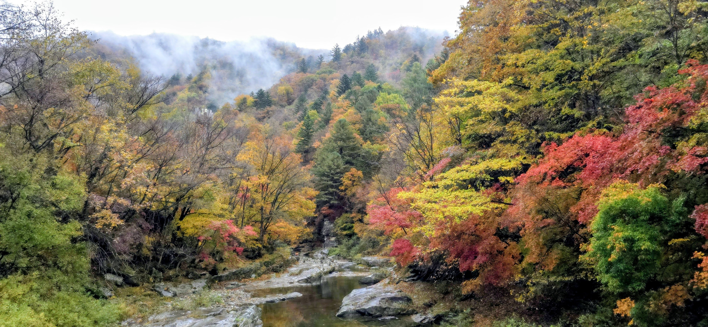
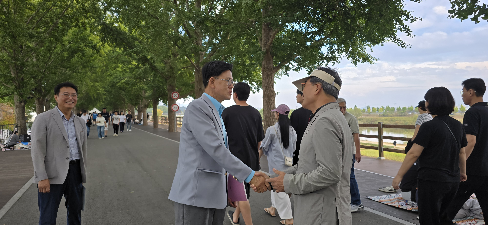
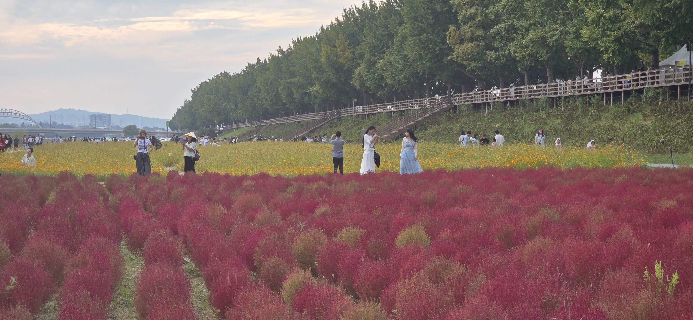
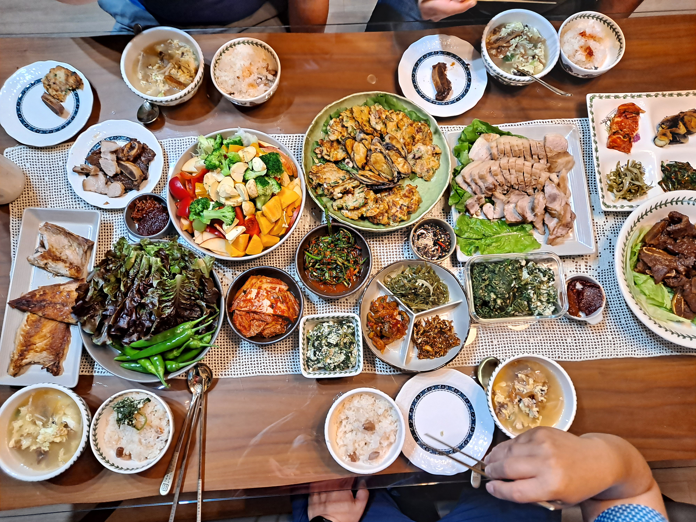

Click here for [English]

---

"참으로 오랜만이었네.

천 년을 사는 은행나무는 몇십 년에 한 번씩 봐도 되지만,

백 년도 못 사는 사람은 몇 년에 한 번이라도 보고 사는 게 친척 아니겠나.

반가웠고 잘 살아줘서 고맙네. 

어디에 얼마나 멀리 살아도 늘 기억하고 추억하며 열심히 살고 건강하세." 

- H 숙부 2026 秋

---

살면서 우리는 적어도 두 종류의 가족을 만나는 축복을 누립니다. 하나는 내가 태어나면서 얻은 가족이고, 다른 하나는 결혼을 통해 인연을 맺게 된 가족입니다.

K 자매와 결혼하면서 나의 세상은 그녀의 친척들로 확장되었습니다. 고모님들 일곱분, 그리고 백부, 숙부 두 분이 계신 큰 가정이었습니다. 백부는 장인님보다 몇 살 위이셨지만, 숙부는 장인님보다 거의 스무 살이나 어려 저희와 연배가 비슷했습니다.

최근 저희는 H 숙부 내외분을 방문하기로 약속을 잡았습니다. 처음에는 그저 저녁 한 끼 간단히 할 생각이었지만, H 숙부은 훨씬 더 좋은 제안을 해주셨습니다.

“그냥 저녁만 먹지 말고, 좀 일찍 와서 나랑 동네 한 바퀴 돌아보자구나.”

그분의 제안에는 삶에서 관계가 어떻게 깊어지는지를 잘 아는 이의 지혜가 담겨 있었습니다.

저희는 은행나무가 흐드러지게 늘어선 차없는 거리를 걸었습니다. 그 길을 걷는 느낌은 그리우면서도 어딘가 미래지향적이었습니다. 

나무 그늘 아래를 걷던 중 H 숙부은 나뭇가지를 올려다보시며 옛 이야기를 꺼내셨습니다. 60여 년 전 중학생 시절, 숙부과 동창들은 수업을 쉬고 당시 10년쯤 된 그 은행나무들을 직접 심었다고 하셨습니다.

제가 농담조로 “그때 강제로 나무 심으시면서 무슨 노동 수용소라도 끌려온 기분은 아니셨나요?” 하고 여쭈었습니다. 그러자 숙부은 이렇게 답하셨습니다.

“아니란다. 우리는 자부심을 가지고 일했어. 여기서 태어나 우리 고향 동네를 우리 손으로 아름답게 가꾸는 일이었으니까.”

길을 걷다 보니 반대편에서 오던 한 무리의 사람들이 반갑게 인사를 건네왔습니다. H 숙부은 마치 오랜 친구를 맞이하듯 그분들을 따뜻하게 환영하셨습니다. 알고 보니 그 친구분은 4선 국회의원이셨습니다. 조금 더 걸어가자 숙부은 같은 학교 출신인 축제 음악 프로그램 담당자에게도 반갑게 손을 흔드셨습니다. 친구와 이웃, 아는 이들의 인사가 끊임없이 이어졌습니다. 
한 동네에서 70년 이상을 살아온 삶이 맺은 귀한 열매였습니다.

이후 숙부은 잘 가꾸어진 꽃밭이 정갈하게 펼쳐진 강변 쪽으로 발걸음을 인도하셨습니다. 물가에 서자 숙부의 관심은 과거에서 저희의 미래로 옮겨갔습니다. 숙부은 재정적인 지혜부터 가족 관계의 미묘한 기술에 이르기까지, 당신의 삶에서 우러나온 진솔한 조언들을 건네주셨습니다. 훈계하는 조가 아니라, 조용하고 깊은 애정을 담은 ‘작은아버지’의 마음으로 말씀해주셨습니다.

발걸음을 돌렸을 때는 이미 저녁 약속 시간에 몇 분 늦은 뒤였습니다.하지만 온양시장 일대가 한눈에 내려다보이는 4층 살림집으로 올라선 순간, 왜 우리가 3시간 동안이나 동네를 돌았는지 비로소 이해할 수 있었습니다.

숙모님(작은엄마)께서는 귀한 손님을 맞이하기 위해 몇 시간, 어쩌면 며칠에 걸쳐 정성껏 만찬을 준비해두셨던 것입니다. 한 상에 그렇게나 많은 음식이 차려진 것은 생전 처음 보았습니다. 하나하나 정성과 사랑이 듬뿍 담겨 있었습니다. 작은엄마를 뵈온 것은 이번이 처음이었고, 오직 결혼이라는 인연으로만 연결된 사이였습니다. 그럼에도 숙모님은 가족을 향한 헌신과 정성 하나만으로 저희를 그토록 극진히 대접해주셨습니다.

이번 방문을 마친 후 제 마음은 풍요로움과 어떤 다짐으로 가득 찼습니다. 결혼을 통해 이렇게 귀한 가족을 얻었음에 깊이 감사하게 되었고, H 숙부처럼 멋진 어른으로 살아가고 싶다는 조용한 결심을 품게 되었습니다.



------------------------------------------------------------------------

## English

> *It really had been such a long time!*
>
> *The ginkgo tree, which lives a thousand years, can be seen once every few decades and still be fine.*
>
> *But people, who don’t even live a hundred years, should see each other at least once every few years—that’s what being relatives is all about.*
>
> *It was so good to see you, and thank you for living well.*
>
> *No matter where we live or how far apart we may be, let’s remember each other, cherish our memories, keep working hard, and stay healthy.*
>
> — **Uncle H, October 2026**

------------------------------------------------------------------------

In life, we are blessed with two families: the family we are born into, and the family we join through marriage.

When I married Sister K, my world expanded to include her extended family—a network that included seven aunts and two uncles.

Her older uncle was a few years senior to her father, while her younger uncle was nearly twenty years younger, making him much closer to our own age.

Recently, we made arrangements to visit this younger uncle, Uncle H, and his new wife.

We had initially planned for a simple dinner, but Uncle H suggested something far better:

> *"Instead of just coming for dinner, come earlier and let me show you around town."*

His invitation demonstrated the wisdom of someone who understands how relationships work in life.

```{r}
#| echo: false
#| warning: false
#| message: false

library(leaflet)

leaflet() |>
  addProviderTiles("OpenStreetMap") |>
  addMarkers(
    lng = 127.00316,
    lat = 36.78055,
    popup = "온양온천역",
    label = "온양온천역"
  ) |>
  addMarkers(
    lng = 127.01813,
    lat = 36.80004,
    popup = "곡교천 은행나무길",
    label = "곡교천 은행나무길"
  ) |>
  fitBounds(
    lng1 = 127.000,
    lat1 = 36.778,
    lng2 = 127.022,
    lat2 = 36.803
  )
```

------------------------------------------------------------------------

Our walk took us along a street lined with ginkgo trees, now transformed into a pedestrian-only avenue

The walk became both nostalgic and futuristic.

As we walked beneath their canopy, Uncle H looked up at the branches and shared a piece of his history.

Some sixty years ago, as a junior high student, he and his classmates were given time off from school to plant those very trees, which were about ten years old at the time.

I asked with a touch of levity if that mandatory planting felt like forced labor in a work camp. He replied,

> *"No, we worked with pride. We were born here, and we were beautifying our own town."*



As we walked, a group coming from the opposite direction stopped to exchange warm greetings. Uncle H welcomed them like old friends.

It turned out his friend was a four-term 국회의원 *Gukhoe-uiwon*—a Member of the National Assembly.

A short distance later, he waved to the chair of the festival music program who had attended the same school he did.

Waves of friends, neighbors, and acquaintances continued to pass by—a fruit of living in the same town for over seventy years.



Eventually, he directed our walk toward the river, where sections of carefully curated flowers bloomed along the banks.

There, by the water, his attention shifted from the past to our future.

He offered us counsel drawn from his own life, ranging from financial wisdom to the nuances of family relations.

He spoke not in a lecturing tone, but with the quiet, concern of a family member, 작은아버지 (*Jageun-abeoji)*—a "little father."

By the time we turned back, we were a few minutes late for dinner.

But as we climbed up to the fourth-floor living area overlooking the Onyang Market 온양시장 area, we understood why we had taken that three-hour detour.

------------------------------------------------------------------------

His wife of six years had spent hours—perhaps days—preparing a feast fit for honored guests.

I had rarely seen so many dishes presented in a single sitting, each one prepared with care and love.

This was my first time meeting 작은엄마, connected to her only through the bonds of marriage.

Yet she honored us out of her devotion and commitment to the family.

I came away from that visit both enriched and resolved—deeply grateful for the family I gained through marriage, and inspired by a quiet resolve to live more like Uncle H.


