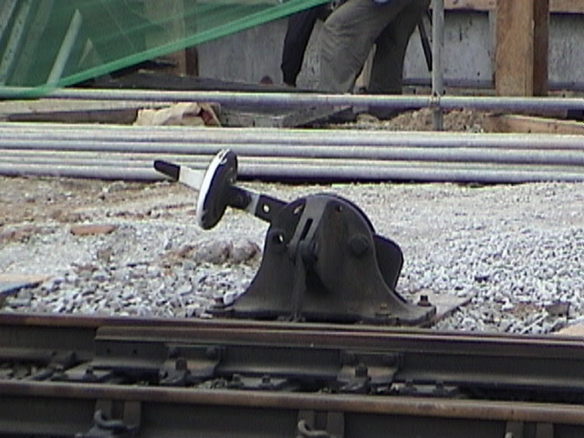

Growing up after the Korean War meant, there would be poverty, shortages and no means of entertainment.

We lived near the railroad tracks and when my father said,

Let's go ride a horse, we all knew what he meant.

We would sit a top of the railroad track switch and pretend that we were riding a horse.

That was the highlight of our existence as a child.

------------------------------------------------------------------------

Fast forward many decades and now I am inundated with gadgets and tools that vie for my time.

------------------------------------------------------------------------

Growing up in the aftermath of the Korean War meant living through a season of universal poverty, chronic shortages, and virtually no external entertainment. Toys were an absolute luxury. Yet, childhood has an incredible way of inventing joy out of absolute scarcity.

We lived near the railroad tracks, and whenever my father would look at us and say, *"Let's go ride a horse,"* we all knew exactly what he meant.

We would walk over to the tracks, climb up onto the heavy iron railroad switch, sit astride it, and pretend we were riding a horse. That simple, shared imagination was the absolute highlight of our childhood existence. A piece of cold iron and a father’s playfulness were more than enough.

Fast forward many decades, and the world has completely inverted.

Now, I am inundated with an overwhelming array of gadgets, screens, and endless tools of distraction—each one competing fiercely for my time and attention. Where we once had to summon imagination out of nothing, we are now constantly fed content that requires no imagination at all.

Looking back at that old railroad switch, I realize the true contrast isn't just about poverty versus wealth or old technology versus new. It is about the quality of our attention. Back then, we had almost nothing, yet we lacked for nothing in wonder. Today, surrounded by infinite tools designed to entertain us, the real challenge is remembering how to sit still, connect deeply, and appreciate the simple fixtures of life that truly matter.
