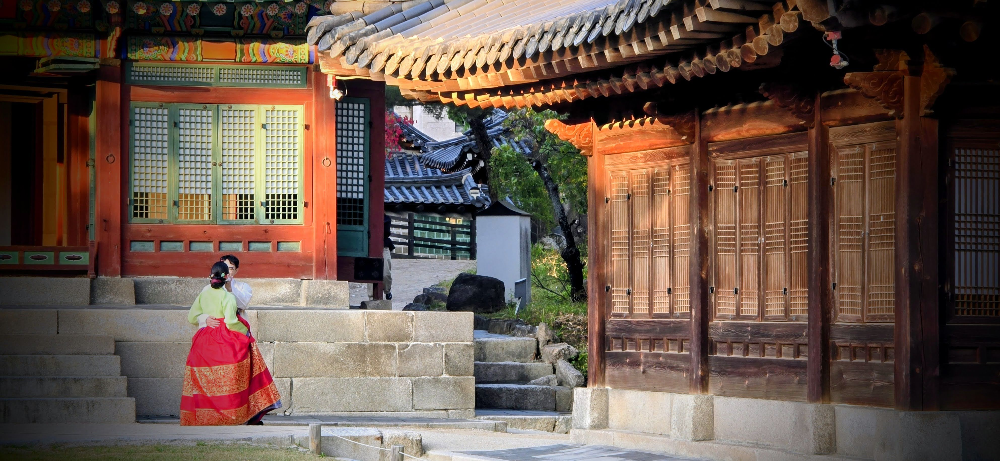

During my younger, traveling years, I made a stopover in Korea on my way home from China.

My father’s youngest brother—my *작은아버지*, who was 53 at the time—met me in downtown Seoul to show me around the city, starting with Gyeongbokgung 경복궁.

As we walked through the grand courtyards of the main palace, framed by elaborately painted timber and sweeping stone grounds, we shared a realization: despite all this royal grandeur, our everyday lives were better than those of the 조선 Joseon Dynasty kings.

At the time of our walk, Korea’s per capita GDP was around \$12,841.

In the years since, that number has nearly tripled to over \$37,000. Even after accounting for cumulative inflation, the real economic growth of the nation has more than doubled.

If we lived richer than ancient kings during my visit, today’s generation enjoys a level of health, warmth, mobility, and comfort that was unimaginable even to those who rebuilt the nation after the war.

Standing inside those grounds, surrounded by thousands of daily visitors, you begin to understand how this happened.

The stone walls of 경복궁 Gyeongbokgung once existed to keep the outside world away, preserving luxury for a select few.

Yet over centuries, those buildings were burned, lost, and painstakingly rebuilt.

The physical timber and stone could always be reconstructed, but what truly endured was something deeper: the spirit of a people who sacrificed, fought, and forged what the world now calls the "Economic Miracle."

In his book *Built to Last*, Jim Collins highlights a core principle of enduring greatness: **"Preserve the Core, Stimulate Progress."**

That is what Korea has accomplished.

By honoring its heritage and identity, the nation preserved its cultural core.

But by relentlessly moving forward—building industries, embracing innovation, and expanding into the future—it created a reality where ordinary citizens live with possibilities no ancient monarch could command.

Today, as millions of people from across the globe travel to experience this vibrant harmony of past and future, the world confirms what was built here: a nation that kept its soul while building tomorrow.

Similarly, we face a similar personal choices.

It doesn't have to either/or decision when it comes to holding onto the tradition or the modern options.

But rather, it is an AND decision, we can keep both the traditional and embrace the future.

It is harder to do but we are far better off when we do.
