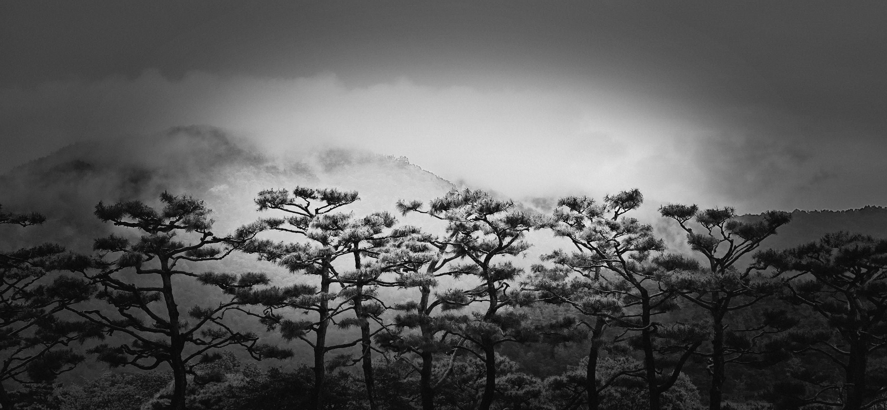

Back in May 1971, our family joined a small congregation in East Incheon (동인천).

The group was organized into a branch and met inside a rented building from the Japanese colonial era. It consisted of just a few dozen people and several families. We would grow together as a family for the next three years within that small organization, before leaving for Maryland in America.

Recently, my sisters and I planned a trip back to Incheon. We wanted to attend that same congregation.

However, as is the case in most places across modern Korea, the original building no longer existed and had been replaced by a much larger, modern edifice.

I contacted a friend from that era to get the meeting time and confirm its new location.

He wished us a good Sabbath day.

------------------------------------------------------------------------

At the beginning of the service, we met the Sister who had been our mother’s close friend. She has been attending this same congregation for over 55 years.

In recent years, following the passing of her husband, she still makes the 30-minute journey on the train and subway from Dowon (도원) to Juan (주안) all by herself.

By coincidence, her oldest daughter was visiting that weekend, as she does once a month.

They invited us to their home—a generous gesture of hospitality, especially since they had no idea we were coming.

It was a reunion filled with the kind of warmth that makes K-dramas worth watching.

Her home was an older-style house with a small footprint, but she had transformed it into her own personal art studio and a thriving arboretum.

Though she had just celebrated her 90th birthday in April, she was single-handedly doing the work of several people.

### The Incheon Matriarch

In between the Sunday meetings, Brother 유, recalling the early days of the branch, mentioned that Sister 임 used to describe her church-related experiences as *소름끼친다*—the Korean equivalent of saying, *"It gives me chills"* or *"goosebumps"* in a positive sense and in awe.

It reminded me of the question posed in the Book of Alma some 2,100 years ago:

> *“And now behold, I say unto you, my brethren, if ye have experienced a change of heart, and if ye have felt to sing the song of redeeming love, I would ask, can ye feel so now?”*

I didn't get the chance to ask Sister 임 if she still feels those chills when she attends church today.

But through five decades of quiet service in the Kingdom, she has continually sung that song of redeeming love.

In her own steadfast way, she has witnessed the truthfulness of it all.

Thank you, Matriarch of Incheon.

1971년 5월, 우리 가족은 동인천에 있는 작은 교회를 나가기 시작했다.

일제강점기에 지어진 오래된 적산가옥 건물 한 켠을 빌려 모이던 작은 지부였다. 다 합쳐봐야 몇몇 가족, 수십 명이 전부였다. 우리는 그 작은 울타리 안에서 3년 동안 서로를 식구처럼 아끼며 함께 자라났고, 이후 미국 메릴랜드로 이주했다.

얼마 전, 누나들과 함께 다시 인천을 찾았다. 옛 시절 추억이 담긴 그 모임에 다시 참석해 보고 싶었지만, 빠르게 변한 한국의 여느 곳이 그렇듯 옛 건물은 이미 흔적도 없이 사라지고 그 자리엔 크고 현대적인 예배당이 들어서 있었다. 그 시절 함께했던 옛 친구에게 연락해 모임 시간과 새 예배당 위치를 알아냈다. 그는 우리에게 정겨운 주일 인사를 건넸다.

예배가 시작될 무렵, 옛날 어머니와 각별하게 지내시던 어르신 한 분을 만났다. 55년이 넘는 세월 동안 한결같이 이 교회를 지켜오신 분이었다. 몇 년 전 할아버지를 먼저 떠나보내신 뒤에도, 도원에서 주안까지 30분이나 걸리는 지하철길을 매주 홀로 오가며 주일을 지키고 계셨다.

마침 그날은 한 달에 한 번 찾아오는 첫째 딸이 다녀가는 날이었다. 두 분은 우리가 찾아올 줄은 꿈에도 몰랐으면서도, 우리를 집으로 따뜻하게 맞아주셨다. K-드라마의 한 장면처럼 가슴 뭉클하고 따스한 재회였다.

어르신의 집은 아담한 옛날식 주택이었지만, 집안은 온통 당신만의 그림 화실이자 아늑한 작은 식물원처럼 꾸며져 있었다. 지난 4월에 이미 구순(90세)을 맞으셨는데도, 어르신은 혼자서 몇 사람 몫의 삶을 생생하고 활기차게 일구어가고 계셨다.

### 인천의 대모님

모임 사이 쉬는 시간에, 옛날 이야기를 나누던 유 형제님이 임 어르신의 젊은 시절 이야기를 전해주셨다. 어르신은 예전에 교회에서 은혜를 입거나 감동을 받을 때마다 항상 \*"소름이 끼친다"\*는 표현을 쓰셨다고 한다. 가슴 깊은 곳에서 밀려오는 거룩한 감격과 전율을 그렇게 표현하셨던 것이다.

그 이야기를 들으니 2,100여 년 전 앨마서에 기록된 글귀가 마음을 울렸다.

> *“너희가 마음의 변화를 겪었고, 구속하시는 그 사랑의 노래를 부르고자 느꼈다면 묻노니, 너희는 지금도 그렇게 느낄 수 있느냐?”*

차마 어르신께 요즘도 예배를 드릴 때 그런 전율을 느끼시는지 직접 여쭈어보지는 못했다. 하지만 지난 50여 년이 넘는 세월 동안 바쳐온 묵묵한 봉사 속에서, 어르신은 삶 전체로 그 사랑의 노래를 계속 불러오셨다. 그리고 당신의 삶 그 자체로 그 가치를 증명해 오셨다.

어르신, 참 감사합니다. 인천의 따뜻한 대모님.
