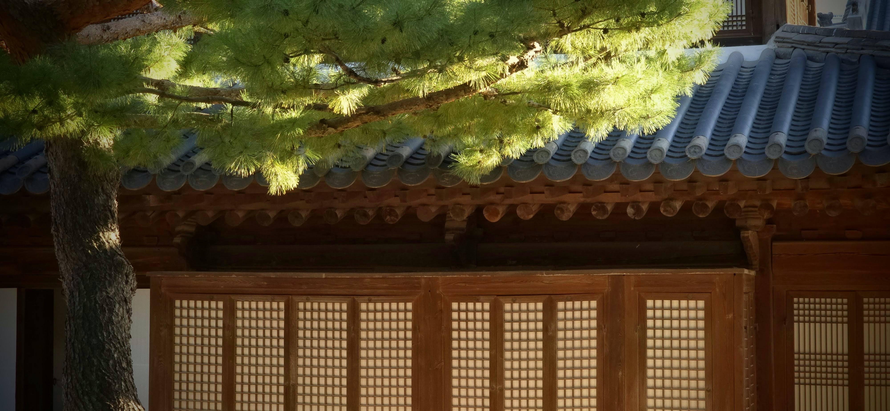

Link to English Version \[[English]\]

최근 몇 년 사이, 아시아의 한 나라를 찾는 외국인 관광객이 부쩍 늘었다.

관광부 발표에 따르면,

> ...코로나19 이후 해외에서 찾아오는 관광객 수가 다시 크게 늘고 있다. 2026년 10월 27일 기준 최신 공식 통계에 따르면 2025년 한 해 동안 1,894만 명의 외국인이 찾아왔고, 2026년 들어서도 첫 9개월 동안에만 1,711만 명이 다녀갔다. 이는 지난 2025년 같은 기간보다 21.5%나 늘어난 수치다.[\^3](https://www.google.com/search?q=%5Bhttps%3A%2F%2Fwww.mcst.go.kr%2Fenglish%2Fpolicy%2FpressView.jsp%3FpSeq%3D675%5D%28https%3A%2F%2Fwww.mcst.go.kr%2Fenglish%2Fpolicy%2FpressView.jsp%3FpSeq%3D675%29)

오랜 역사가 담긴 궁궐부터 요즘 인기를 끄는 카페까지, 관광객들은 수도 서울은 물론 순천처럼 그리 널리 알려지지 않은 정겨운 곳으로도 발길을 잇고 있다.

인터넷을 통해 조용히 뻗어나간 문화의 힘과 이 나라에 대한 세계인들의 관심 덕분에, 동남아시아와 동아시아는 물론 영국이나 프랑스 같은 유럽 나라들에서도 많은 이들이 찾아온다.

그리고 그 사람들 속에는 나 같은 이들도 있다.

우리는 서류상으로는 미국에서 온 관광객으로 분류되지만, 사실은 우리가 태어난 고향을 찾아온 사람들이다.

우리는 보통의 관광객과는 조금 다른 시선과 마음으로 이곳에 들어선다. 우리는 수십 년 전 두고 떠나온 이들에게 전해주려고, 제2의 조국에서부터 챙겨온 선물로 가방을 가득 채워 찾아오는 사람들이다.

1934년에 나온 한 옛 노래에는 이런 가사가 있다[\^4](https://www.google.com/search?q=%5Bhttps%3A%2F%2Fencykorea.aks.ac.kr%2FArticle%2FE0058719%5D%28https%3A%2F%2Fencykorea.aks.ac.kr%2FArticle%2FE0058719%29),

> 타향이라 정이 들면 내 고향 되는 것을
>
> 가도 그만 와도 그만 언제나 타향.

서구 사회의 문화와 생활 방식에 익숙해지고 이를 받아들이며 살아왔지만, 내 안에는 다른 곳에서 배우고 다루는 방식과 여전히 잘 맞지 않는 마음의 결들이 남아있다. 가족이라는 울타리의 의미와 그 숭고한 역할에 대한 생각이 그렇다.

그 경계는 어디쯤일까? 가족이라는 보이지 않는 끈을 서로 아끼고 지켜내야 한다는 책임감은, 어느 순간에 이르러서야 개인의 자유와 독립이라는 현대적인 생각보다 앞서게 되는 걸까?

내가 어릴 적 모습을 기억해 주는 분들이 이제는 손에 꼽을 만큼만 남아있다. 이번 길에 그분들을 찾아뵈어 지난 옛날 이야기를 함께 나누었다.

나를 기억해 주는 이야기들, 그리고 온 마음으로 챙겨주신 따뜻한 대접과 사랑 속에서 나는 비로소 마음이 든든하게 채워지는 기분을 느꼈다.

나는 앞으로도 이 삶이라는 방랑의 길을 계속해서 걸어갈 것이다. 하지만 내 뿌리에 대해서만큼은, 내가 어디에서 왔는지 또 언젠가 어디로 돌아가 모이게 될지 잘 알고 있다.

그러기에, 나는 내가 누구인지 안다.

바다 건너 가져온 선물들을 다 나누어주고 나니, 가방은 K자매가 부탁한 영양크림 몇 개와 화장품을 빼고는 거의 비어있다.

하지만 나는 손에 잡히는 물건보다 훨씬 더 귀한 선물을 안고 돌아간다. 내가 남한에 정착해 새로운 나라와 어우러지면서도 당당하게 삶을 일구어낸 이북 실향민의 후손이라는 사실, 그리고 미국에서 기독교적이고 서구적인 유산 속에서 배우며 자랐다는 사실을 다시금 마음 깊이 확인한 것이다.

이 두 가지 뿌리 모두에 깊이 감사한다. 한자리에 서서 지나온 삶을 돌아보고, 참으로 수많은 이유로 고마움을 느낄 수 있다는 사실에 말이다.

## English

One country in Asia has seen a large increase in tourists in recent years.

According to the Ministry of Tourism,

...inbound tourism has rebounded strongly since the COVID-19 pandemic. The latest official figures available as of October 27, 2026, show 18.94 million international visitors in 2025, followed by 17.11 million in the first nine months of 2026, a 21.5% increase over the same period in 2025.[^1]

[^1]: https://www.mcst.go.kr/english/policy/pressView.jsp?pSeq=675

From historical palaces to trendy cafes, tourists are flocking to the capital as well as lesser-known places like Suncheon (순천).

Driven by the quiet power of the internet and a global fascination with the culture, visitors arrive from East and Southeast Asia, as well as European nations like England and France.

------------------------------------------------------------------------

Then there are those like me.

We are categorized as tourists from the USA, yet we are also visiting the land of our birth.

We carry a unique perspective and different expectations. We are the ones who arrive with a suitcase full of items to share from our adopted land with those we left behind many decades ago.

A popular song released in 1934 states[^2],

[^2]: https://encykorea.aks.ac.kr/Article/E0058719

> 타향이라 정이 들면 내 고향 되는 것을 가도 그만 와도 그만 언제나 타향.

"If a stranger's land grows dear to the heart, it becomes a home of its own—" "Yet whether coming or going, a life away from home remains ever a wandering."

Though I have grown accustomed to and adopted many practices of Western civilization, there are parts of me that still cannot reconcile certain feelings with what is taught and practiced elsewhere—such as the composition and sacred role of families.

Where does the line fall? At what point does the greater good of the collective—the unspoken obligation to honor, protect, and preserve the family unit—override the modern allowance for individual autonomy?

------------------------------------------------------------------------

There are a handful of people left who knew me as a child. I was able to visit with them and relive the old days.

Through their recollections and their display of love and charity—evidenced by their warm hospitality—I was made whole.

I will continue on the path of wandering in this life. But as for my roots, I know where I am from, and I know where I will ultimately be gathered.

Therefore, I know who I am.

Having distributed the gifts brought across the ocean, I am left with a largely empty suitcase—save for a few requested jars of night cream and cosmetics for Sister K.

Yet I carry back a far greater gift than anything tangible: a reminder that I belong to a lineage of North Korean refugees who settled in South Korea and built a remarkable life, both independent and intertwined with their new country; and furthermore, that I was educated and raised in the United States with Christian and Western traditions.

For both of these heritages, I am deeply appreciative. That I can stand in one place, think through my life, and be thankful in more ways than one.
