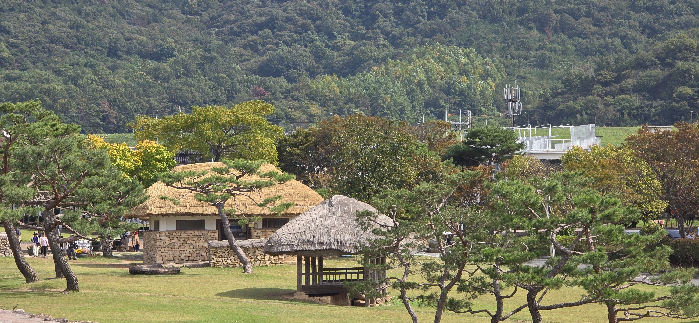

Link to Korean Version [Korean]

John Denver sang of country roads leading to a home.

I returned to South Korea as a driver, after a twenty-four-year absence.

The last time I drove here, I lived in the Daegu area, navigating a landscape that still held a balance of urban streets and rural stretches.

My ancestral roots are in North Korea—a place I cannot drive to, leaving that countryside fixed in memory, much like the song.

South Korea, by contrast, has altered its physical terrain, tunneling through mountains and spanning rivers with bridges to tie its cities closer together.

Between 2002 and 2025, the country’s total road network expanded from 96,037 to 116,775 kilometers—a net increase of roughly 902 kilometers per year. Over that same period, registered vehicles grew by 90 percent, jumping from 14 million to 26.5 million. The machine population nearly doubled while human population growth plateaued.

Driving these expanded routes requires a different set of habits than it did two decades ago. Earlier driving relied on direct observation—reading landmarks, physical signs, and visual line-of-sight. Modern driving in Korea is an exercise in split attention: listening to GPS applications constantly announcing section-by-section speed enforcement cameras, reading vibrant, color-coded lane tracks painted on the asphalt at highway interchanges (reminiscent of Mario Kart), and watching overhead LED gantries that guide and tax electronic pass users

The physical space has expanded, but so has the cognitive load of navigating it.

In the Western United States, where I have spent most of my driving years, cities were often laid out on wide grids, with interstate corridors planned before major urban sprawl set in. In places like Utah, roads are mostly straight, long, and predictable. In Korea, villages and ancient paths existed long before cars arrived; modern infrastructure was carved directly into centuries-old neighborhoods.

Driving through the Seoul metropolitan area feels less like a daily commute and more like an arcade game. You navigate narrow alleys never meant for automobiles, sudden overpasses, subterranean tunnels, and two-wheeled delivery couriers operating on an entirely different plane of risk. It feels like a race where every driver is maneuvering for pole position and the checkered flag.

Initially, I tried to keep up and imitate the aggressiveness of the native drivers.

Then I noticed something.

At a macro level, after a period, the heaviest traffic congestion eventually works itself free—almost like a parting of the Red Sea.

In real time, at the micro level, I realized that if I simply slowed down a bit, other drivers would either navigate around me or I would naturally drift away from a potential predicament.

Looking back ten days later, the experience feels almost surreal. I find myself wondering if I actually drove those roads and survived. If nothing else, I have a renewed appreciation for urban drivers in Korea: most of them could easily skip driving school and go straight to the professional racing circuit.

Yet behind the wheel in that hyper-modern maze, a quieter realization took hold.

North Korea remains locked in the static memory of what was, while South Korea hurtles into what will be.

I hold out hope that one day the North will open its borders, paving the way for transcontinental road and rail lines.

When those highways finally connect the entire Korean Peninsula to China, Russia, and beyond, drivers can test the limits of their engines against an open horizon, rather than maneuvering against their fellow travelers in the tight lanes of Seoul.

------------------------------------------------------------------------

## Korean

존 덴버는 고향으로 이끄는 시골길을 노래했다.

나는 24년 만에 운전대를 잡고 다시 한국 땅을 밟았다.

이곳에서 마지막으로 운전했던 시절, 나는 대구에 살며 도시의 도로와 정겨운 시골길이 조화를 이루던 풍경 속을 누비곤 했다.

나의 뿌리는 이북에 있다. 차를 타고 가볼 수 없는 그곳의 시골 풍경은 존 덴버의 노래 가사처럼 내 기억 속에 아득하게 멈춰 서 있다.

반면 남한의 풍경은 몰라보게 달라졌다. 산마다 터널을 뚫고 강마다 다리를 놓아 도시와 도시 사이를 바짝 이어 놓았다.

2002년에서 2025년 사이, 한국의 도로망은 9만 6천 킬로미터에서 11만 6천 킬로미터로 늘어났다. 매년 약 900킬로미터씩 길을 새로 낸 셈이다. 같은 기간 등록된 차량 수는 1,400만 대에서 2,650만 대로 90퍼센트나 급증했다. 인구 증가세는 주춤한 반면, 도로 위 자동차 수는 거의 두 배로 늘어났다.

이렇게 확 넓어진 도로를 달리는 데는 20년 전과는 또 다른 운전 습관이 필요했다. 예전 운전이 주위 풍경과 도로 표지판, 눈앞의 시야에 의존하는 방식이었다면, 요즘 한국에서의 운전은 끊임없이 신경을 분산시켜야 하는 고난도 작업이다. 구간 단속 카메라를 끊임없이 읊어대는 내비게이션 소리에 귀를 기울여야 하고, 고속도로 분기점마다 도로 바닥에 그어진 알록달록한 유도선(마치 마리오 카트 게임을 떠올리게 하는)을 따라가야 하며, 하이패스 차로를 안내하고 통행료를 거둬들이는 머리 위 LED 전광판도 계속 살피며 달려야 한다.

도로라는 물리적 공간도 넓어졌지만, 그 길을 찾아가기 위해 머릿속으로 처리해야 할 정보의 양도 그만큼 엄청나게 늘어난 것이다.

내가 운전 인생의 대부분을 보낸 미국 서부는 도심이 넓은 바둑판 모양으로 짜여 있고, 도시가 본격적으로 커지기 전에 주간 고속도로망이 먼저 들어섰다. 유타주 같은 곳은 도로가 대부분 곧고 널찍하며 예측하기 쉽다. 하지만 한국은 차가 생기기 오래전부터 마을과 옛길들이 이미 자리 잡고 있던 곳이다. 현대식 도로망은 몇 백 년 된 옛 동네 골목골목을 그대로 파고들며 만들어졌다.

서울 수도권을 운전하다 보면 매일 하는 출퇴근이라기보다 아케이드 오락실 게임을 하는 기분이 든다. 원래는 자동차용이 아니었던 좁은 골목길, 갑자기 나타나는 고가도로, 어두운 지하 터널, 그리고 전혀 다른 차원의 위험을 감수하며 달리는 오토바이 배달 라이더들 사이를 요리조리 헤쳐 나가야 한다. 마치 모든 운전자가 선두 자리를 차지하고 결승선을 가장 먼저 통과하기 위해 경쟁하는 레이싱 경주장 같다.

처음에는 나도 현지 운전자들처럼 분위기를 맞춰가며 거칠게 달려보려고 했다.

그러다 문득 한 가지를 깨달았다.

멀리서 크게 바라보면, 그렇게 막히던 도로도 시간이 조금 지나면 마치 모세의 기적처럼 꽉 막힌 흐름이 뻥 뚫린다는 사실이다.

그리고 바로 눈앞의 순간을 보면, 내가 속도를 조금만 줄여도 다른 차들이 알아서 나를 비켜 가거나 위험한 상황에서 자연스럽게 벗어날 수 있었다.

열흘이 지난 지금 돌아보니, 그때의 경험이 마치 꿈만 같게 느껴진다. '내가 정말 그 도로들을 직접 운전하고 무사히 살아 돌아온 걸까?' 싶기도 하다. 다른 건 몰라도 한국의 운전자들에 대한 존경심만큼은 새로 생겼다. 그곳 운전자들 대부분은 운전학원을 건너뛰고 곧바로 카레이서로 데뷔해도 손색이 없을 정도다.

하지만 이 초현대적인 도로의 미로 속에서 운전대를 잡고 있는 동안, 가슴 한구석에는 조용한 깨달음 하나가 자리 잡았다.

북녘 땅은 여전히 과거의 시간에 정지된 기억으로 남아있지만, 남한은 앞으로 다가올 미래를 향해 정신없이 달려가고 있다는 사실이다.

언젠가 북한도 문을 열고, 대륙을 잇는 도로와 철길이 시원하게 뚫리는 날이 오기를 희망해 본다.

그 고속도로가 마침내 한반도 전역을 넘어 중국으로, 러시아로, 그리고 더 넓은 세상으로 이어지는 날, 운전자들은 서울의 좁은 차선 속에서 서로 아웅다웅하는 대신 넓게 펼쳐진 지평선을 향해 마음껏 엑셀을 밝으며 엔진의 한계를 시험해 볼 수 있을 것이다.
