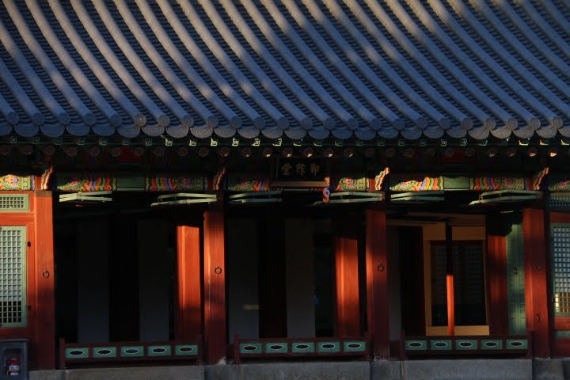

Link to English ([English])

오늘날 시대를 이끄는 거물급 기업가들은 다음 세대에게 미심쩍고 앞뒤가 맞지 않는 기준을 보여주고 있다.

그들의 행동은 단순히 \*"내 말대로만 하고, 내 행동은 따라 하지 마라"\*는 식을 넘어, 사회의 보편적인 규칙조차 자신들에게는 해당되지 않는다고 말하는 듯하다. 남들은 범접할 수 없는 막대한 부는 물론이고, 연일 세간의 입방아에 오르내리는 스캔들과 저버린 신의마저 성공의 사소한 뒷이야기쯤으로 여겨진다. 일단 정상에 오르면 과거의 약속쯤은 선택 사항이 된다는 생각을 당연하게 만들고 있는 것이다.

얼마 전, K자매가 이와는 극명하게 대비되는 오래된 옛이야기 하나를 들려주었다.

후한 시대, 광무제(기원전 5년 – 서기 57년)의 누이인 호양공주가 남편을 잃고 홀로 지내게 되었다. 누이의 행복을 염려한 황제는 조정 신하들의 인물평을 나누며, 공주가 마음에 두고 있는 이가 누구인지 조심스레 떠보았다.

공주는 이렇게 답했다. “신하들 가운데 품격과 인품, 덕망에서 송홍을 따라올 사람이 없습니다.”

“한번 알아보겠소.” 황제가 말했다.

얼마 뒤 황제는 송홍을 궁으로 부르면서, 공주를 보이지 않는 병풍 뒤에 앉혀 두었다. 신하의 마음을 시험하고자 황제가 물었다. “세상 사람들이 흔히 말하기를, \*‘지위가 높아지면 친구를 바꾸고, 부자가 되면 아내를 바꾼다’\*고 하더군. 그것이 그저 사람의 본성인가?”

송홍은 망설임 없이 대답했다. “제가 듣기로, 가난할 때 사귄 옛 친구는 결코 잊어서는 안 되며, 어려운 시절을 함께 견뎌준 아내는 집 밖으로 내보내지 않는다고 했습니다.”

이 말을 들은 황제는 병풍 쪽을 돌아보며 조용히 말했다. “이번 혼사는 아무래도 어렵겠소.”

이 일화에서 조강지처(糟糠之妻)라는 말이 유래했다. 글자 그대로는 ‘술지게미와 쌀겨를 함께 먹으며 고생한 아내’, 즉 미천하고 어려웠던 시절을 함께한 아내를 뜻한다. 훗날 부와 지위를 얻었다는 이유만으로 젊은 날의 고난을 함께 나눈 아내를 저버려서는 안 된다는 가르침이다.

구약성경 역시 이와 같은 분명한 기준을 기록하고 있다.

> “여호와께서 너와 네가 어려서 맞이한 아내 사이에 증인이 되시느니라. 그는 네 짝이요 너와 서약한 아내로되 네가 그에게 거짓을 행하였도다.”
>
> — 말라기 2장 14절

수 세기의 시간과 대륙을 건너고, 서로 전혀 다른 전통 속에서도 진정한 인품을 가늠하는 잣대는 한결같다. 부와 권력은 한 사람의 주변 환경을 바꿀 수 있을지 몰라도, 그 사람의 진정한 품격은 결국 무엇을—그리고 누구를—끝까지 저버리지 않고 지켜내는가에서 드러난다.

------------------------------------------------------------------------

## English

Today’s Captains of Industry are setting dubious and conflicting standards for future generations.

It is not enough that their behaviors imply not only *"do as I say, not as I do,"* but also that the normal rules of society do not apply to them.

Beyond their unmatched wealth, their headline-grabbing dalliances and fractured loyalties are treated as mere footnotes to their success—normalizing the idea that once a person reaches the top, past commitments are optional.

Recently, Sister K shared an ancient story that offers a lasting counterpoint.

During the Eastern Han dynasty, Emperor Guangwu’s ([**광무제**](https://namu.wiki/w/%EA%B4%91%EB%AC%B4%EC%A0%9C)5BC - 57AD) elder sister, Princess Huyang, had recently been widowed.

Looking out for her happiness, the emperor discussed his court officials with her, quietly trying to discover whom she favored.

She replied, “None of the officials can match Song Hong in dignity, character, and virtue.”

“I’ll see what can be done,” the emperor said.

Later, he summoned Song Hong to court while seating the princess behind a screen out of sight. Testing his minister, the emperor asked,

“There is a common saying: *‘When a man rises in status, he changes his friends; when he becomes wealthy, he changes his wife.’* Is that simply human nature?”

Song Hong answered without hesitation: “I have heard that one must never forget old friends made in poverty, nor abandon the wife who stood by him in hard times.”

Hearing this, the emperor turned toward the screen and said quietly, “I’m afraid this match isn’t going to happen.”

------------------------------------------------------------------------

From this exchange comes the idiom **糟糠之妻** (*조강지처*)—literally, "the wife of chaff and dregs," or the wife of humble beginnings.

A man must never discard the woman who shared his early hardships simply because he later achieves wealth or status.

The Old Testament records:

> *“The LORD hath been witness between thee and the wife of thy youth, against whom thou hast dealt treacherously.”*
>
> — Malachi 2:14 (KJV)

Across centuries, continents, and different traditions, the measure of true character remains consistent.

Wealth and power may alter a person's surroundings, but integrity is revealed in what—and whom—they refuse to leave behind.

------------------------------------------------------------------------

## Internet Resources

<https://www.youtube.com/shorts/fhgNQ9D4AYo>

From <https://namu.wiki/w/%EC%A1%B0%EA%B0%95%EC%A7%80%EC%B2%98>

時帝姊湖陽公主新寡，帝與共論朝臣，微觀其意。主曰：「宋公威容德器，群臣莫及。」帝曰：「方且圖之。」後弘被引見，帝令主坐屏風後，因謂弘曰：「諺言貴易交，富易妻，人情乎？」弘曰：「臣聞貧賤之知不可忘，**糟糠之妻**不下堂。」帝顧謂主曰：「事不諧矣。」
